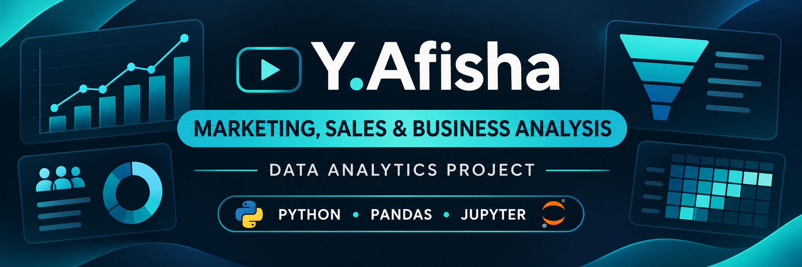
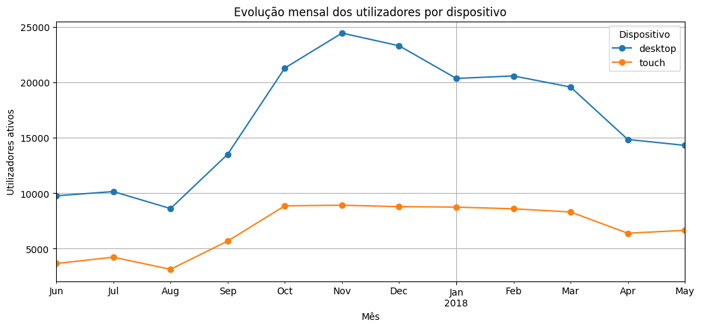
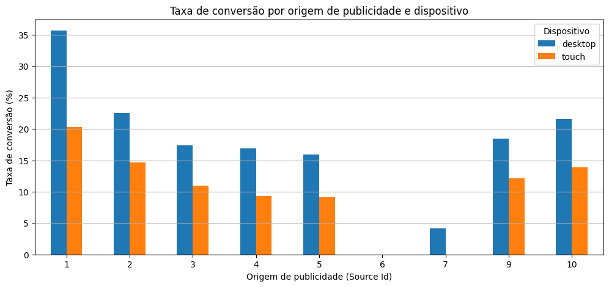
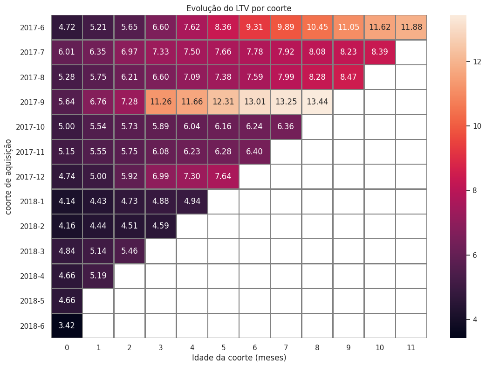
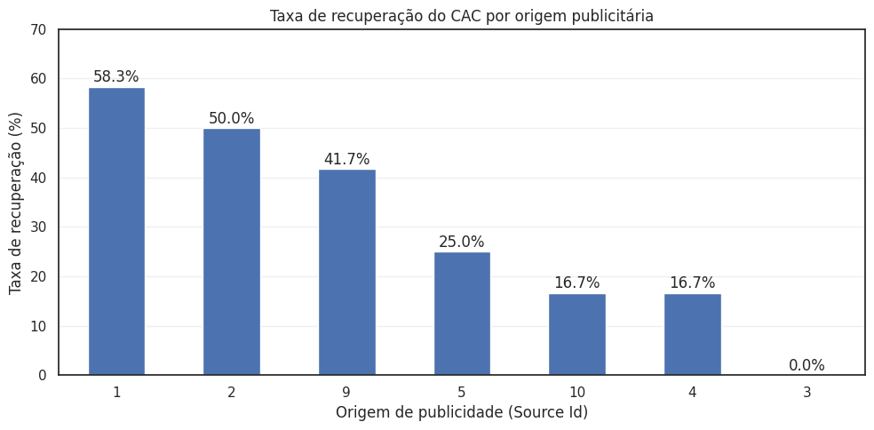

<p align="center">
  
</p>

# Y.Afisha — Marketing, Sales and Business Analysis

## Project Overview

This project analyzes the business performance of Y.Afisha, an online entertainment platform, using data on user activity, customer purchases, and marketing expenses.

The main goal is to understand how users interact with the platform, evaluate purchasing behavior, measure customer value, and identify which advertising sources generate the most efficient returns on marketing investment.

The analysis was conducted as part of the Data Analytics program at TripleTen.

## Business Objectives

The project focuses on three main areas:

- **Product Analysis:** Understand user activity, session behavior, engagement, and retention across devices and advertising sources.
- **Sales Analysis:** Evaluate conversion rates, purchasing behavior, average order value, and Customer Lifetime Value (LTV).
- **Marketing Analysis:** Assess advertising expenses, calculate Customer Acquisition Cost (CAC), evaluate Marketing Return on Investment (ROMI), and measure CAC payback by acquisition cohort.

## Dataset Description

The analysis uses three datasets provided by TripleTen:

| Dataset | Description |
|---|---|
| `visits_log_us.csv` | User visits, sessions, devices, and advertising sources. |
| `orders_log_us.csv` | Customer orders and purchase revenue. |
| `costs_us.csv` | Marketing expenses by advertising source and date. |

**Note:** The original CSV files are not included in this repository because they were provided by TripleTen for educational purposes.

For instructions on preparing the datasets, see [`data/README.md`](data/README.md).

## Tools and Technologies

- **Python** — Data analysis and processing.
- **Pandas** — Data manipulation and aggregation.
- **NumPy** — Numerical operations.
- **Matplotlib** — Data visualization.
- **Seaborn** — Statistical data visualization.
- **Jupyter Notebook** — Interactive analysis and documentation.

## Project Workflow

### 1. Data Preparation

- Loaded and inspected the three datasets.
- Checked data types, missing values, and duplicates.
- Optimized data types to improve memory efficiency.
- Prepared date and time variables for analysis.

### 2. Product Analysis

- Analyzed daily, weekly, and monthly active users (DAU, WAU, and MAU).
- Evaluated session frequency and duration.
- Investigated user return rates.
- Compared user behavior across devices and advertising sources.

### 3. Sales Analysis

- Identified the time between the first visit and the first purchase.
- Calculated overall and segmented conversion rates.
- Analyzed purchasing frequency and average order value.
- Evaluated customer lifetime value (LTV) using cohort analysis.
- Compared six-month LTV across advertising sources and devices.

### 4. Marketing Analysis

- Evaluated advertising expenses by acquisition source.
- Calculated Customer Acquisition Cost (CAC).
- Compared revenue and marketing investment through ROMI.
- Calculated cumulative LTV by acquisition cohort.
- Compared LTV against CAC to identify investment recovery.
- Analyzed cohort recovery rates and median payback periods.

## Key Findings

### 1. Product Analysis

- Average daily active users (DAU): **908**.
- Average weekly active users (WAU): **5,716**.
- Average monthly active users (MAU): **23,228**.
- Only **22.85%** of users had more than one session during the observation period.
- Desktop accounted for **164,523 unique users**, compared with **71,345** on touch devices.
- Desktop users generally showed longer sessions and higher return rates across most advertising sources.

<details>
<summary>Product Analysis Visualization</summary>



</details>

### 2. Sales Analysis

- Overall visitor-to-customer conversion rate: approximately **16%**.
- Desktop conversion rate: **18.17%**.
- Touch conversion rate: **10.85%**.
- Average orders per customer: **1.38**.
- Average order value: **$5.00**, with a median of **$2.50**.
- Source 1 achieved the highest overall conversion rate, at approximately **30.62%**.

The six-month LTV analysis highlighted the following segments:

| Advertising Source | Device | Six-Month LTV |
|---|---|---:|
| Source 1 | Desktop | $13.94 |
| Source 2 | Desktop | $13.13 |
| Source 2 | Touch | $11.41 |
| Source 5 | Desktop | $11.09 |

These results indicate that customer value varies across acquisition sources and devices.

<details>
<summary>Sales Analysis Visualization</summary>



</details>

<details>
<summary>Customer Lifetime Value Visualization</summary>



</details>

### 3. Marketing Analysis

Total marketing expenditure amounted to **$329,131.62**.

Source 3 accounted for the largest share of the marketing budget, with **$141,321.63**, representing approximately **42.9%** of total expenditure.

The ROMI analysis revealed significant differences across advertising sources:

| Source | ROMI | CAC |
|---|---:|---:|
| 1 | +49.24% | $7.19 |
| 2 | +9.62% | $12.21 |
| 9 | +4.38% | $5.07 |
| 5 | +1.67% | $7.47 |
| 4 | -7.17% | $5.93 |
| 10 | -23.57% | $4.38 |
| 3 | -61.43% | $13.49 |
| 7 | Not calculable | Not calculable |

Source 7 had one recorded buyer but no registered marketing expenditure. Therefore, its CAC and ROMI could not be calculated.

The cohort payback analysis showed:

- **Source 1:** 58.33% cohort recovery rate, with a median payback of 1 month.
- **Source 2:** 50% cohort recovery rate, with a median payback of 4 months.
- **Source 9:** 41.67% cohort recovery rate.
- **Source 3:** No recovery among its 12 eligible cohorts during the observed period.

ROMI is based on revenue relative to advertising expenditure and does not represent net profit, as other operating costs are not included.

<details>
<summary>Marketing Analysis Visualization</summary>



</details>

## Business Recommendations

Based on the findings, the following actions are recommended:

1. **Reallocate part of Source 3's budget:** Test an initial 10% reduction in Source 3's advertising expenditure, freeing approximately **$14,132.16**.

2. **Increase investment in Source 1:** Allocate approximately **$8,479.30** of the released budget to Source 1, which achieved the highest ROMI and cohort recovery rate.

3. **Increase investment in Source 2:** Allocate approximately **$5,652.86** to Source 2, which also achieved positive ROMI and a 50% cohort recovery rate.

4. **Monitor Sources 5 and 9:** Both sources achieved slightly positive ROMI and should be monitored before considering significant budget increases.

5. **Improve the touch experience:** Investigate the conversion gap between desktop and touch devices to identify potential improvements in the mobile purchasing experience.

6. **Monitor acquisition performance:** Track CAC, ROMI, conversion rates, LTV, and cohort payback to evaluate the impact of budget changes.

The proposed budget reallocation is an initial test scenario. Its impact should be measured before implementing further changes.

## Project Structure

```text
y-afisha-marketing-analysis/
│
├── data/
│   └── README.md
│
├── images/
│   ├── customer_ltv.png
│   ├── marketing_analysis.png
│   ├── product_analysis.png
│   └── sales_analysis.png
│
├── notebooks/
│   └── y_afisha_marketing_analysis.ipynb
│
├── .gitignore
└── README.md
```

## How to Run

### 1. Clone the repository

```bash
git clone https://github.com/etienne-94/y-afisha-marketing-analysis.git
```

### 2. Navigate to the project directory

```bash
cd y-afisha-marketing-analysis
```

### 3. Install the required libraries

```bash
pip install pandas numpy matplotlib seaborn jupyter
```

### 4. Prepare the datasets

Place the three original CSV files provided by TripleTen inside the `data/` directory.

The filenames must remain unchanged.

Refer to [`data/README.md`](data/README.md) for further information.

### 5. Launch Jupyter Notebook

```bash
jupyter notebook
```

Open `notebooks/y_afisha_marketing_analysis.ipynb` and run the analysis.

## Author

**Etienne Viegas dos Santos**

Data Analytics Student — TripleTen

GitHub: [etienne-94](https://github.com/etienne-94)